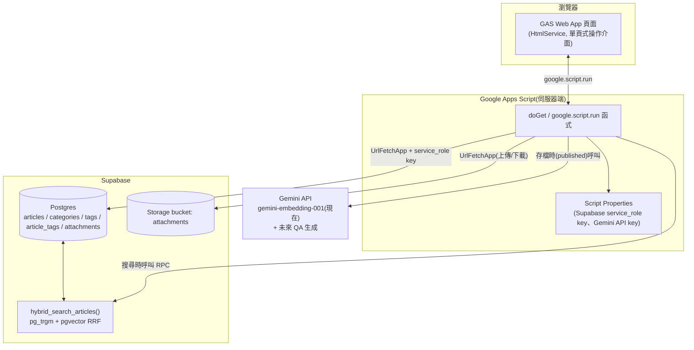

# GAS + Supabase 個人/團隊知識庫

[](https://github.com/slc6172/KnowledgeBase/actions/workflows/test.yml)

以「文章為核心、實作附件為支撐」的知識庫系統。Google Apps Script 當操作介面與
後端代理,Supabase(Postgres + pgvector + Storage)當資料儲存與搜尋引擎,
Gemini API 負責語意向量與(未來)AI 問答。

## 特色

- **文章管理**:Markdown 編輯(EasyMDE)、2 層分類、標籤(自動建議 + 自由輸入)、
  草稿/發布狀態
- **多型態附件**:程式碼、圖片、Zip、Markdown 筆記、Office 文件、PDF、ODF 文件、
  外部連結,依副檔名自動判斷類型
- **附件線上預覽**:圖片縮圖、PDF/Office 文件內嵌檢視、程式碼語法高亮、
  Markdown 渲染
- **Hybrid Search**:`pg_trgm`(關鍵字,對中文友善)+ `pgvector`(語意向量)用
  RRF 融合排序,標籤可疊加篩選
- **零/低成本架構**:GAS + Supabase 免費方案,未來可無縫接入 Gemini API 做
  「AI 知識庫問答」

## 架構



完整的架構決策紀錄與取捨理由見 [`docs/DESIGN.md`](docs/DESIGN.md)。

## 技術棧

| 項目 | 選擇 |
|---|---|
| 前端 | Google Apps Script HtmlService(單頁式,無框架)、[EasyMDE](https://github.com/Ionaru/easy-markdown-editor)、[marked.js](https://marked.js.org/)、[highlight.js](https://highlightjs.org/) |
| 後端 | Google Apps Script(V8 runtime) |
| 資料庫 | [Supabase](https://supabase.com/)(Postgres + `pgvector` + `pg_trgm`) |
| 檔案儲存 | Supabase Storage |
| Embedding | Gemini `gemini-embedding-001` |
| 測試 | Jest(後端邏輯;前端無自動化測試,見下方說明) |

## 專案結構

```
.
├── src/                  GAS 原始碼 —— clasp push 這個資料夾
│   ├── appsscript.json   Apps Script 專案設定
│   ├── *.gs               後端(11 個)+ 前端進入點(WebApp.gs)
│   └── *.html             前端視圖與樣式(8 個)
├── test/                  Jest 單元測試(只涵蓋後端邏輯)
│   └── helpers/           測試用的假 httpFetch_/PropertiesService/Utilities
├── docs/
│   ├── DESIGN.md          架構與決策紀錄(/grilling 訪談結果)
│   ├── schema.sql         Supabase 資料庫 schema(含 hybrid search RPC 函式)
│   ├── specs/             各功能的規格文件(/to-spec 產出)
│   ├── tickets/           開發過程的任務拆解紀錄(/to-tickets 產出,依功能分資料夾)
│   └── preview/           前端的靜態預覽工具(不是部署檔案,說明見下方)
├── package.json / jest.config.js / babel.config.js
└── .clasp.json.example    clasp 設定範本,複製成 .clasp.json 並填入自己的 scriptId
```

## 快速開始

### 1. 建立 Supabase 專案

1. 到 [Supabase](https://supabase.com/) 建立新專案。
2. 把 [`docs/schema.sql`](docs/schema.sql) 貼到 SQL Editor 執行——會建立所有資料表、
   索引,以及 `hybrid_search_articles` 這個搜尋用的 RPC 函式。
3. 到 Storage 建立一個名為 `attachments` 的 bucket(不用設為 public,全部走
   service_role key 存取)。
4. 到 **Settings → API Keys**,切到 **Legacy API Keys** 分頁,記下 Project URL
   和 **`service_role`**(JWT 格式,`eyJ...` 開頭)。

   > ⚠️ **一定要用 Legacy 分頁的 `service_role`,不要用新版的 secret key
   > (`sb_secret_...`)、也不要用 anon/publishable key。**
   >
   > 新版 secret key 會主動偵測請求的 User-Agent,只要「像瀏覽器」就一律回
   > 401——而 Google Apps Script 的 `UrlFetchApp` 送出去的 User-Agent 固定是
   > `Mozilla/5.0 (compatible; Google-Apps-Script; ...)`,**沒有辦法自訂或
   > 覆蓋**(Google 官方文件明講、社群多年前提的功能需求也一直沒處理)。這串
   > UA 会被新版 secret key 判定成瀏覽器直接擋掉,從 Apps Script 打新版
   > secret key 保證失敗,不是設定錯誤。
   >
   > **已知風險**:Supabase 官方文件寫舊版 key 會在 **2026 年底前**逐步淘汰。
   > 如果屆時被強制淘汰、Google 那邊又還沒開放自訂 `UrlFetchApp` 的
   > User-Agent,這個「GAS 直接用 `UrlFetchApp` 打 Supabase」的架構會整個
   >失效,需要另外加一層不受這個限制的代理(例如 Supabase Edge Function)
   > 才能繞過。現在不需要處理,但部署前你應該知道這個風險存在——建議定期
   > 回來看 Supabase 的[金鑰遷移公告](https://supabase.com/docs/guides/api/api-keys),
   > 有變化再重新評估。

### 2. 取得 Gemini API Key

到 [Google AI Studio](https://aistudio.google.com/apikey) 建立一組 API key,
用於產生文章與搜尋查詢的 embedding 向量。

### 3. 部署到 Apps Script

```bash
npm install -g @google/clasp   # 如果還沒裝過
clasp login

# 建立新的 Apps Script 專案(或用既有專案的 scriptId)
clasp create --type webapp --rootDir ./src

# 或者:複製設定範本，填入既有專案的 scriptId
cp .clasp.json.example .clasp.json
# 編輯 .clasp.json,填入你的 scriptId

clasp push
```

部署後,在 Apps Script 編輯器裡:

1. 打開 `Config.gs`,找到 `setupScriptProperties()`,把裡面四個預留字串換成
   步驟 1、2 拿到的真實值(`WRITE_PASSWORD` 自己定一個寫入密碼),選取該函式
   並執行一次(把金鑰跟密碼寫進 Script Properties,不會出現在程式碼或版本
   控制裡)。
2. 部署 → 新增部署 → 網頁應用程式:執行身分選「我」,誰可以存取選
   「任何人」——這個 app 刻意設計成不需要登入 Google 帳號就能看(讀取類
   操作對任何人開放),寫入類操作則由 `Auth.gs` 的共用密碼守門員擋著,見下方
   「已知問題修復紀錄」第 8 條。如果選「僅限自己」,除了你以外誰都打不開這個
   網址,等於失去共用密碼保護原本要達成的「多人可用」目的。
3. 開啟部署後的網址即可使用。

### 4. 跑測試(選用)

```bash
npm install
npm test
```

80 個測試涵蓋所有後端邏輯(文章 CRUD、附件上傳/預覽、搜尋、分類/標籤、共用密碼
寫入保護),透過把唯一對外的 HTTP 呼叫點(`httpFetch_`)替換成假回應來驗證,
不需要真的連上 Supabase 或 Gemini。詳細測試設計可以參考 `docs/specs/` 裡每份
spec 的 Testing Decisions 段落。

## 前端測試方式的說明

前端(`src/*.html` + 部分 `.gs`)沒有自動化測試——`google.script.run` 沒有
現成的可替換測試接縫,要做到跟後端一樣的紅綠循環,需要先花一輪工程幫它包一層
類似 `httpFetch_` 的介面,這在當初的 spec 裡明確列為 Out of Scope。

替代方案是 `docs/preview/Preview.html`:把 `src/Index.html` 裡 Apps Script 用來
引入檔案的樣板標籤都解析成靜態內容,並把 `google.script.run`
換成回傳假資料的 mock,讓開發時不用每次都重新部署到 Apps Script 就能用瀏覽器
直接打開檢查介面。**這不是部署檔案**,純粹是開發輔助工具。

## 已知問題修復紀錄(2026-08-19)

實際部署後回報的問題,依序修好的:

1. **發布時分類沒存到最新的**:`publishArticle()` 對已存在的文章只呼叫了
   `setArticleStatus`,沒有先把表單上的最新內容存進去——已修正為先
   `updateArticle` 再切換發布狀態。
2. **草稿存了找不到**:文章列表新增「已發布/草稿/全部」篩選下拉,原本預設只抓
   已發布,草稿永遠不會出現在畫面上。
3. **附件只能在詳情頁附加**:附件上傳/清單區塊改成存草稿(拿到文章 id)後就直接
   顯示在編輯頁裡,不用先跳到詳情頁。附件相關邏輯重構成 `mountAttachmentPanel()`
   共用函式,詳情頁跟編輯頁共用同一份,不是各寫一份。
4. **中文檔名附件失敗**:Storage 路徑不再放原始檔名,改用 uuid + 副檔名(純
   ASCII),原始檔名(含中文)完整保留在資料庫的 `file_name` 欄位。
5. **附件上傳出現 RLS 錯誤**:根本原因是新版 Supabase secret key 會擋掉
   Apps Script 的固定 User-Agent(見上方「建立 Supabase 專案」段落的警告框),
   改用 Legacy `service_role` key 解決。同時 `Config.gs` 現在會自動去除讀出來
   的值前後空白,並提供 `debugConfig()` 診斷函式(在 Apps Script 編輯器手動
   執行,安全地確認金鑰有沒有讀對,不會洩漏完整金鑰)。
6. **搜尋出現不相關的文章**:`hybrid_search_articles` 新增
   `max_semantic_distance` 參數(預設 0.6),語意比對距離超過門檻的結果會被
   排除——**這個改動在 `docs/schema.sql` 裡,需要重新到 Supabase SQL Editor
   跑一次 `create or replace function`** 才會生效(是安全的重跑,不會影響
   既有資料)。
7. **沒有刪除文章的功能** 與 **文章列表新增分類篩選**:`deleteArticle` 現在會
   先清掉所有附件的 Storage 檔案再刪文章(避免孤兒檔案);文章列表新增分類
   篩選下拉,跟狀態篩選並列。
8. **多人使用(共用密碼寫入保護)**:確認過 Apps Script 的身分辨識機制不好用
   (取決於團隊是否共用同一個 Google Workspace 網域,不通用),改採更簡單的
   方案——不是真正的「登入制」,而是 Web App 部署為完全公開,讀取類操作
   (`listArticles`/`getArticle`/`searchArticles`/`listAttachments`/
   `getSignedAttachmentUrl`/`getTextAttachmentContent`/`listCategories`/
   `listTags`)任何人都能直接呼叫;寫入類操作(建立/編輯/刪除文章、附件
   上傳/加連結/刪除、分類建立/改名/刪除,共 10 個函式)一律改成透過新增的
   `Auth.gs`——`callProtected(password, functionName, args)` 驗證共用密碼後
   才轉呼叫真正的函式,密碼存在 Script Property `WRITE_PASSWORD`
   (`setupScriptProperties()` 會一併設定)。前端第一次寫入時跳出密碼輸入
   modal,輸對後密碼存在記憶體變數裡,同一次瀏覽階段(SPA 不重新整理頁面)
   不用重複輸入;密碼錯誤會清掉快取,下次寫入重新詢問。
   已知取捨(沿用原本設計時就預期到的限制):只能分辨「有沒有輸入對密碼」,
   無法分辨是誰做的修改,沒有個人帳號、沒有稽核軌跡——單人/小團隊信任彼此的
   情境下夠用,真的需要問責追蹤要另外做 Auth/RLS。
9. **PDF 附件預覽被 Chrome 擋掉**:Apps Script Web App 本身跑在 Google 加的
   一層 sandbox iframe 裡,PDF 直接塞進另一個 iframe 會變成巢狀 sandbox,
   Chrome 內建的 PDF 檢視外掛拒絕在這種情境下渲染(手動驗收時實測到,
   Network 面板顯示檔案其實有下載下來、但被標記 `blocked:other`)。改成跟
   `office_doc` 一樣走 Google Docs Viewer(`docs.google.com/viewer`)嵌入,
   不直接依賴瀏覽器內建的 PDF 外掛。
10. **搜尋出現 `TypeError: rankedRows.map is not a function`,完全沒有搜尋結果**:
    根本原因是 `hybrid_search_articles` 改參數列表(新增
    `min_full_text_similarity`)時用 `create or replace function` 部署,但
    PostgreSQL 判斷「要不要取代舊函式」是看參數列表,參數列表一變就會變成
    多一個重載版本而不是真的取代掉舊的——資料庫裡因此同時存在好幾個不同參數
    數量的版本,PostgREST 收到沒有指定新參數的呼叫時無法判斷要叫哪一個,
    回傳一個描述衝突的物件而不是查詢結果陣列,`.map` 就在這個物件上炸開。
    修法分兩層:(a) 到 Supabase 用 `drop function if exists
    hybrid_search_articles(...)` 明確砍掉舊的參數簽名,只留一個版本;
    (b) `Search.gs` 的 `searchArticles` 加了防呆,RPC 回傳不是陣列時丟出
    清楚的錯誤訊息(說明可能是新舊函式版本衝突),不會再讓使用者看到看不懂的
    `TypeError`。已實測確認修復。
11. **展開「瀏覽全部標籤」下拉清單時,同一列的按鈕會一起被撐高**:清單元素
    原本是一般的區塊元素,展開時撐開自己所在的 flex 容器高度,連帶把同一列
    的其他按鈕一起拉高(原生 `<select>` 的下拉選項不會有這個問題,那是瀏覽器
    自己浮動渲染,不佔版面高度)。改成跟既有的打字自動建議下拉一樣用
    `position: absolute` 浮動顯示,不再佔用文件流高度。
12. **取消批次勾選後,「已選取 X 篇」文字沒有跟著消失**:根本原因是既有的
    CSS 規則順序問題——`.hidden { display: none }` 寫在 `.batch-toolbar {
    display: flex }` 前面,兩個選擇器優先度相同時「後寫的贏」,`.batch-toolbar`
    的 `display: flex` 一直贏過 `.hidden`,工具列其實從來沒有真的被隱藏過。
    這個問題可能影響任何「元件自己設定 `display` 又疊加 `.hidden`」的地方,
    改成 `.hidden { display: none !important; }` 讓它保證優先。
13. **分享按鈕點下去沒有任何反應**:原本用 `google.script.url.getLocation()`
    想拿目前網址,但查證 Apps Script 官方文件後確認那個 API 回傳的物件只有
    `hash`/`parameter`/`parameters` 三個欄位,根本沒有 `href`,原本的寫法
    存取到 `undefined`,在非同步 callback 裡丟出沒被接住的錯誤。改成新增一個
    唯讀的 `getWebAppUrl()`(`ScriptApp.getService().getUrl()`)讓前端透過
    `google.script.run` 呼叫取得正確的部署網址。
14. **批次加標籤的輸入框太寬**:原本沒有寬度限制,會撐滿彈性版面剩餘的空間,
    改成固定寬度。
15. **搜尋跟 AI 問答的語意比對門檻太鬆,不相關的內容也會混進結果**:
    `max_semantic_distance` 原本的預設值 0.6 太寬鬆——手動測試「test」跟
    「clasp」這兩篇完全不相關的文章,量出來的語意距離是 0.539,比 0.6 還近,
    會被誤判成「夠相關」。收緊到 0.4(`docs/schema.sql` 的函式預設值,以及
    `Search.gs`/`RagChat.gs` 呼叫時也明確帶這個值,兩邊保持一致)。這個數字
    是文章數量還很少時的粗略校準,樣本變多之後可能需要再調——已實測確認
    目前的搜尋結果符合預期。
16. **AI 問答面板每搜尋一次就多疊一輪,越用越長**:這是更早一輪刻意設計的
    「多輪對話疊加顯示」,但實際使用起來體驗不好,改成每次搜尋只保留、顯示
    最新一輪(對話歷史 `conversationHistory` 不受影響,還是完整送給 Gemini
    維持多輪之間的回答連貫,只是畫面上不再疊加顯示過去幾輪)。已實測確認
    修復。
17. **共用密碼保護(第 8 條)其實只在前端擋,伺服器端沒有強制執行**:一次
    資安審查發現,`Auth.gs` 的白名單/`callProtected` 只在「前端選擇透過這個
    入口呼叫」時才生效——Apps Script 的規則是專案裡所有沒有底線字首的頂層
    函式,一律會自動暴露成任何頁面載入時就能直接呼叫的公開端點,跟這個函式
    有沒有被前端實際呼叫過無關。原本的 20 個寫入函式(第 8 條提到的建立/
    編輯/刪除文章、附件、分類等操作)、`SupabaseClient.gs` 的 6 個泛用資料庫
    存取函式(`supabaseRequest` 這一層甚至等於是把整個資料庫的完整讀寫權限
    包成一個沒有限制的代理端點)、以及 `debugConfig()`/`setupScriptProperties()`
    這兩個只該手動執行一次的函式,全部都屬於這種情況,理論上密碼保護可以被
    完全繞過。修法是把這 28 個函式全部改名加底線字首,讓 Apps Script 平台
    本身不再自動暴露它們,對外操作名稱(`callProtected` 用的字串)不受影響;
    `debugConfig`/`setupScriptProperties` 兩個現在要手動執行時,需要先暫時
    把底線拿掉存檔、執行完再改回來。同時新增一個靜態測試,讀取原始碼文字
    斷言這批函式宣告都帶底線字首,避免以後有人不小心讓某個函式重新曝光時
    要等到下一次資安審查才會發現。已跑過完整測試套件確認修復,行為本身
    (含第 8 條描述的密碼驗證流程)沒有改變。
18. **分享連結網址的文章 id 沒有正確跳脫,理論上可以被拿來注入可執行內容**:
    同一次資安審查也發現,`Index.html` 原本用不跳脫的樣板標籤,把分享連結
    網址帶入的文章 id(任何人都可以自訂的查詢參數)直接印進一段指令碼區塊,
    只靠手動 `JSON.stringify` 包一層——但這樣不會跳脫斜線字元,只要組一個
    帶特殊內容的連結,就能提早結束外層區塊、讓後面的內容被當成新的可執行
    內容解讀。修法是把這個值改成先寫進 `body` 元素的一個資料屬性,搭配平台
    本身會依輸出情境自動跳脫的樣板標籤(不是原本那種不跳脫版本)輸出,前端
    改成從這個屬性讀值;沒有帶分享連結參數時的預設值也從 `null` 改成空
    字串,避免印進屬性後變成字面上的 `"null"` 文字被誤判成有值。新增一個
    靜態測試斷言舊寫法不會再出現、新寫法確實存在。已用帶有可執行內容片段的
    分享連結網址親手測過,確認畫面上不會執行到任何非預期內容。
19. **文章內文/附件預覽/AI 問答回答的 Markdown 內容未消毒就顯示**:同一次
    資安審查也發現,文章內文(`content_md`)、md_file 附件預覽、AI 問答回答
    這三處都是把 `marked.parse()` 的結果直接指定給 `innerHTML`。Markdown
    規格本身允許內嵌原生 HTML,如果內容裡帶有可執行內容,會在畫面顯示時
    原樣執行。修法是新增 DOMPurify(透過既有的 CDN 載入方式引入,跟
    marked.js/highlight.js/easymde 同一種模式),三個呼叫點的 `marked.parse()`
    結果都先經過 `DOMPurify.sanitize()` 消毒再指定給 `innerHTML`。新增一個
    靜態測試斷言這三處都有消毒、且沒有殘留舊的直接指定寫法。已貼一篇帶有
    可執行內容片段的 Markdown 內容親手測過上述三處,確認不會執行到任何
    非預期內容,且既有的語法上色效果不受影響。
20. **組資料庫查詢條件時沒有做 URL 編碼**:同一次資安審查也發現,`Articles.gs`/
    `Categories.gs`/`Tags.gs`/`Attachments.gs`/`Embeddings.gs`/
    `RelatedArticles.gs`/`Search.gs` 這 7 個檔案裡,總共約 34 處用手動字串
    相加組出 PostgREST 過濾條件(`欄位=eq.值`、`欄位=in.(值1,值2)` 這類寫法),
    沒有對值做任何編碼。標籤名稱、分類名稱這類自由文字輸入的欄位如果值裡
    帶有 `&`、`,` 這類 PostgREST 保留字元,理論上可以附加或干擾查詢裡其他
    參數的語意。修法是在 `SupabaseClient.gs` 新增 `eqFilter_`/`inFilter_`
    兩個共用輔助函式,內部用 `encodeURIComponent` 做編碼,7 個檔案的 34 處
    全部換成呼叫這兩個函式——不只限於目前已知會吃自由文字輸入的欄位,任何
    組進過濾條件的值都一併套用,屬於縱深防禦:即使某個 id 目前只會是資料庫
    產生的 UUID,也不假設它以後或透過其他呼叫路徑永遠安全。每個檔案都補上
    對應的「值含特殊字元時,實際送出去的 URL 有正確編碼」測試案例。已跑過
    完整測試套件確認修復,行為本身沒有改變。
21. **附件的自訂網址沒有驗證協定**:同一次資安審查也發現,`addAttachmentUrl_`
    存新增附件的自訂網址時完全不檢查格式,前端顯示附件連結時又是直接把值
    指定給 `<a>` 的 `href`——理論上可以存入一個看起來像連結、點下去卻會被
    瀏覽器當成可執行程式碼的網址。修法是伺服器端(`Attachments.gs`)只接受
    `http://`/`https://` 開頭的網址,其餘一律拒絕並回傳明確錯誤;前端存檔
    表單新增 `isSafeAttachmentUrl_` 做同樣的檢查,送出前先擋、提早顯示
    錯誤訊息——伺服器端驗證才是真正的防線,前端純粹是提早給回饋。後端補上
    對應測試(拒絕非 http/https 協定、不會打任何網路請求);前端這次因為
    是不依賴 DOM 的純函式,直接把函式文字從原始碼抽出來還原成可呼叫的
    函式寫行為測試,不只是文字比對。

## 開發過程文件

這個專案是透過 `/grilling`(架構訪談)→ `/to-spec`(規格書)→
`/to-tickets`(任務拆解)→ `/tdd`(紅綠重構,後端)的流程逐步建置的。完整的
決策脈絡與每個功能的取捨理由都留在 `docs/` 底下,包含:

- 每一份 spec 的 *Implementation Decisions* 段落記錄了具體技術選擇跟理由
- 每一份 spec 的 *Further Notes* 段落記錄了開發過程中查證外部文件(Supabase
  Storage API、PostgREST + pgvector 參數格式等)得到的結論
- `docs/tickets/` 底下每張票的 acceptance criteria 就是該功能實際做到的範圍

## 授權

未附加 LICENSE,預設保留所有權利(私人/團隊內部使用)。
