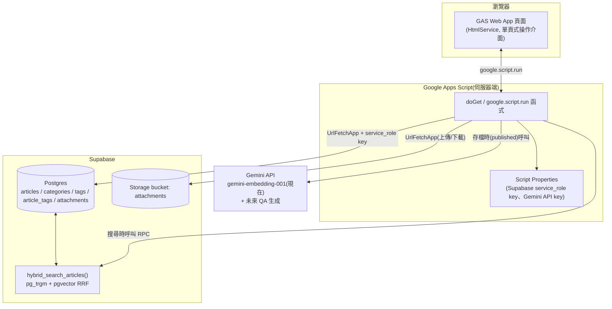

# GAS + Supabase 個人知識庫 — 設計文件

以「文章為核心、實作附件為支撐」的個人知識庫。GAS 作為操作介面與後端代理,
Supabase(Postgres + Storage)作為資料儲存與搜尋引擎,未來可接 Gemini API 做問答。

## 1. 決策紀錄

| # | 決策點 | 結論 |
|---|---|---|
| 1 | 使用範圍 | 單人,不做 Supabase Auth / RLS |
| 2 | GAS 角色 | 後端代理:HTML 頁面 → `google.script.run` → Apps Script 伺服器函式 → `UrlFetchApp` → Supabase(用 service\_role key,存 Script Properties,不進瀏覽器) |
| 3 | 內容格式 | 純 Markdown 原文,前端用 `marked.js` 渲染 |
| 4 | 分類結構 | 2 層(`categories` 表 + `parent_id` 自參照,UI 限制 2 層,DB 天生支援未來擴展) |
| 5 | 附件語意 | 心得/歷程算文章本文(寫進 `content_md`);附件表只放檔案/連結(code / photo / zip / md_file / office_doc / pdf / odf_doc / url) |
| 6 | Embedding | Gemini `gemini-embedding-001`(GA 模型,`outputDimensionality: 768` 對齊 `vector(768)` 欄位;2026-08-15 查證後由 `text-embedding-004` 更新過來),文章 `status` 轉為 `published` 時同步呼叫產生/更新 |
| 7 | 規模 | 以文字為主,Free Plan(DB 500MB / Storage 1GB)預期足夠,使用者自行監控 |
| 8 | Embedding 分段 | 整篇文章一個向量(不切 chunk),存在 `articles.embedding` |
| 9 | 附件儲存 | 單一 Storage bucket `attachments`,路徑 `{article_id}/{uuid}_{file_name}` 分資料夾 |
| 10 | 標籤輸入 | 自由輸入 + 自動建議既有標籤(前端 autocomplete) |
| 11 | 搜尋體驗 | 統一搜尋列,pg\_trgm(關鍵字)+ pgvector(語意)用 RRF 融合排序,標籤為 AND 篩選疊加 |
| 12 | 關鍵字搜尋引擎 | `pg_trgm`(而非 `tsvector`)——Supabase 未提供中文斷詞擴充套件(zhparser 等),trigram 對中文更合適,已用本地文件確認 |
| 13 | 草稿 | 有:`articles.status` = `draft` / `published`;草稿不產生 embedding、預設不進搜尋結果 |
| 14 | 版本歷史 | 不做,編輯直接覆蓋 |
| 15 | 刪除 | 硬刪除,不做回收桶 |
| 16 | 附件線上預覽 | photo(縮圖)、md_file(渲染)之外,新增 **pdf / code / office_doc** 三種線上預覽;zip、odf_doc、url 維持檔名/連結,無線上預覽(見第 3.1 節) |

## 2. 架構圖

## 3. 主要資料流

**建立/編輯文章**
1. 使用者在 GAS 頁面寫 Markdown、選分類、打標籤(自動建議既有標籤)。
2. `google.script.run` 送到 Apps Script 伺服器函式。
3. 伺服器函式用 `UrlFetchApp` + service\_role key 寫入 `articles`(status 預設 `draft`)、
   同步/更新 `article_tags`。
4. 若使用者將 `status` 設為 `published`:伺服器函式呼叫 Gemini `gemini-embedding-001`
   產生向量,一併寫回 `articles.embedding`。草稿階段不呼叫 embedding API。

**上傳附件**
1. 使用者在文章詳情頁選檔案(code / photo / zip / md\_file / office\_doc / pdf / odf\_doc)或貼 URL。
   `type` 可由副檔名自動判斷(GAS 端做對照表,如 `.docx/.xlsx/.pptx` → `office_doc`、
   `.odt/.ods/.odp` → `odf_doc`),不用使用者手動選。
2. 檔案型:前端把檔案轉 base64 送 `google.script.run` → 伺服器函式解碼後用
   `UrlFetchApp` 上傳到 Storage bucket `attachments/{article_id}/{uuid}_{filename}`,
   並在 `attachments` 表寫入一筆記錄(`file_path`、`file_name`、`file_size`)。
3. URL 型:直接寫入 `attachments`(`type='url'`, `url=...`),不經 Storage。
4. 因目前規模以文字檔為主(已確認),先不做 Storage 簽名 URL 直傳「上傳」,全部走 GAS 代理即可
   ——但簽名 URL 會用在「預覽」上,見下方 3.1。

### 3.1 附件線上預覽機制

| type | 預覽方式 |
|---|---|
| `photo` | 縮圖(既有) |
| `md_file` | Markdown 渲染(既有) |
| `pdf` | GAS 呼叫 Supabase Storage API 產生短效簽名 URL(建議 5 分鐘過期),前端 `<iframe src="{signedUrl}">` 用瀏覽器原生 PDF 檢視器渲染,不需額外套件 |
| `code` | 內容不對外曝露:GAS 伺服器端用 service\_role key 直接讀取檔案文字(建議設大小上限,如 1MB,超過只給下載連結),透過 `google.script.run` 回傳純文字給前端,用 client-side 語法高亮套件(如 highlight.js,依副檔名判斷語言)渲染 |
| `office_doc` | 產生簽名 URL,前端內嵌 Google Docs Viewer:`https://docs.google.com/viewer?url={簽名URL}&embedded=true` |
| `odf_doc` / `zip` / `url` | 無線上預覽,維持檔名 + 下載連結(Google Docs Viewer 對 ODF 支援不穩定) |

⚠️ **`office_doc` 的取捨**:簽名 URL + Google Docs Viewer 是最簡單的做法,但代表檔案內容會在
預覽當下,透過一個短效期、無索引的公開連結被 Google 的檢視服務讀取一次——嚴格來說內容短暫
離開了 Supabase。如果文件內容偏敏感、不希望有任何形式對外曝露,兩個替代方案:(a) 不做線上
預覽,只保留下載;(b) 改用 Drive API 把檔案暫存轉成 Google 文件格式,用原生 Drive 檢視器渲染
(不經 Google Docs Viewer 這個外部服務,但要多串接 Drive API、管理暫存檔案生命週期,複雜度較
高)。目前先採簽名 URL 方案,之後想換更嚴謹的做法,不影響現有 schema,只是換一支 GAS 函式的
實作。

新增的 GAS 伺服器函式:
- `getSignedAttachmentUrl(attachmentId, expiresInSeconds)` — 給 `pdf` / `office_doc` 用
- `getCodeAttachmentContent(attachmentId)` — 給 `code` 用,內建大小上限判斷

**搜尋**
1. 使用者在統一搜尋列輸入文字、可選標籤篩選。
2. 伺服器函式呼叫 Gemini 產生 `query_text` 的 embedding。
3. 呼叫 Supabase RPC `hybrid_search_articles(query_text, query_embedding, ..., tag_ids)`,
   一次拿到融合排序後的文章列表(草稿預設排除)。

## 4. 假設與後續可調整項(非重大決策,先用合理預設,之後隨時可改)

- 附件不做跨文章的獨立瀏覽/篩選頁,只在對應文章底下顯示清單。
- 附件預覽:各類型的預覽方式與取捨已整理在 3.1 節,不重複列在這裡。
- 標籤篩選採 **AND** 語意(需同時符合所有勾選標籤),已寫進 `hybrid_search_articles`。
- 「發布」只是 `status` 欄位切換,沒有版本快照;之後想加版本歷史可另建
  `article_revisions` 表 + trigger,不影響現有 schema。

## 5. 建議實作順序

1. Supabase 專案建立 → 執行 `schema.sql`(含 extensions、資料表、索引、hybrid search function)。
2. GAS 專案:Script Properties 設定 Supabase URL / service\_role key / Gemini API key。
3. 文章 CRUD(含分類、標籤)→ 先能存取 `draft`,測試 `published` 時的 embedding 產生。
4. 附件上傳(先支援單一類型如 photo,跑通 Storage 流程再擴展其他類型)。
5. 搜尋頁:串 `hybrid_search_articles`,先驗證 pg\_trgm 對中文查詢的比對效果
   (必要時調整 `full_text_weight` / `semantic_weight` 比重)。
